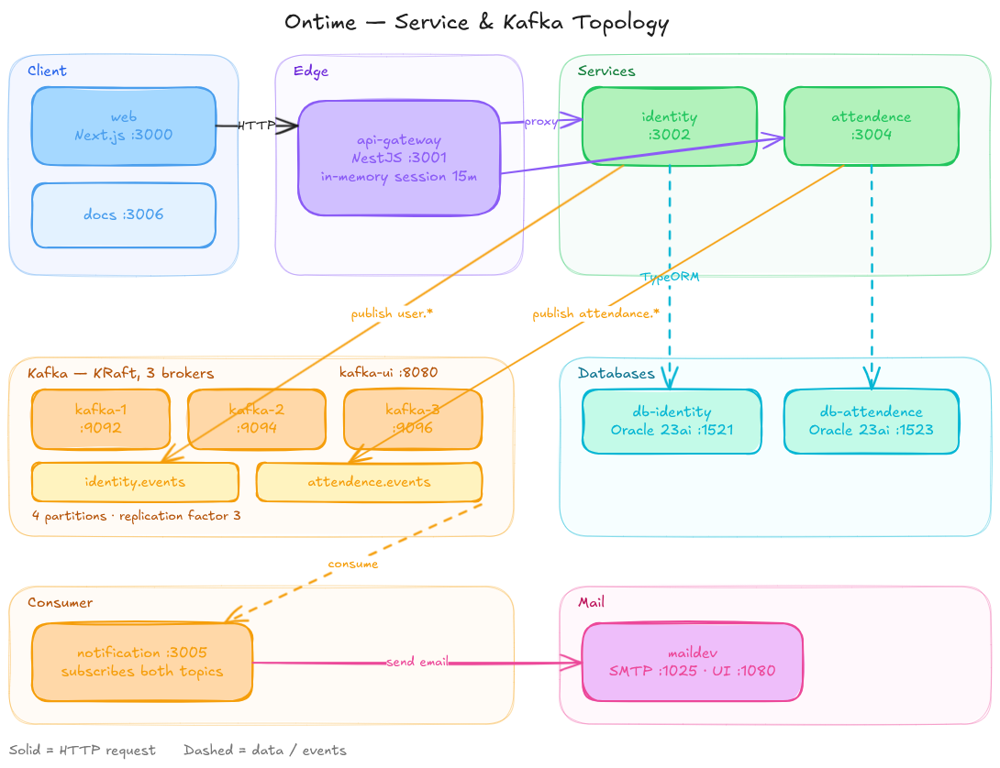

# Ontime

Employee attendance for a company. Employees check in with a camera photo and GPS location; masters manage staff and monitor attendance.

## Run it

```sh
cp .env.example .env
docker compose up -d
npm install
npm run dev
```

Web: http://localhost:3000 — master signs in with `master@ontime.local` / `MasterPass1`.

## Architecture



Solid lines are HTTP requests; dashed lines are data and events.

## API documentation

Every client-facing endpoint, with request bodies and success responses: [Ontime API on Postman](https://documenter.getpostman.com/view/26492730/2sBYHYswmb)

## Services & ports

| Service | Port | What it does |
| --- | --- | --- |
| `web` | 3000 | Next.js client |
| `api-gateway` | 3001 | Session auth, routing, role checks |
| `identity` | 3002 | Users, roles, passwords |
| `attendence` | 3003 | Check-in / check-out, photo proof |
| `notification` | 3004 | Kafka consumer, sends emails |

## Infrastructure ports

| Component | Port |
| --- | --- |
| `kafka-1` / `kafka-2` / `kafka-3` | 9092 / 9094 / 9096 |
| `kafka-ui` | 8080 |
| `db-identity` | 1521 |
| `db-attendence` | 1523 |
| `maildev` SMTP / UI | 1025 / 1080 |

Kafka topics: `identity.events`, `attendence.events` — 4 partitions, replication factor 3.

## Stack

- **Language**: TypeScript
- **Monorepo**: Turborepo, npm workspaces
- **Backend**: NestJS 12, TypeORM, Oracle Database 23ai Free, Kafka (kafkajs), sharp
- **Frontend**: Next.js 16, React 19, Tailwind CSS v4, shadcn/ui + Fluid Functionalism
- **Auth**: in-memory sessions in the gateway, bcryptjs password hashing
- **Email**: nodemailer to MailDev
- **Tests**: Vitest
- **Lint / format**: oxlint, Prettier
